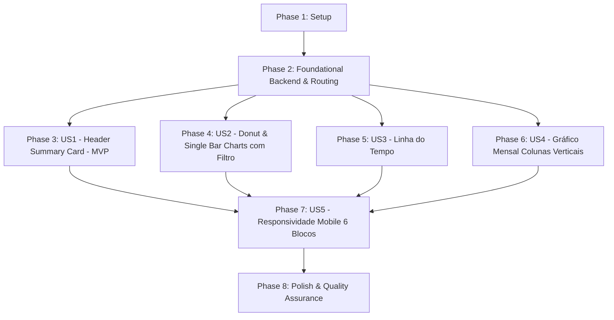

# Tasks: Dashboard Detalhado de Movimentações com Gráficos

**Feature**: `006-dashboard-movimentacoes`  
**Branch**: `006-dashboard-movimentacoes`  
**Specification**: [spec.md](./spec.md) | **Plan**: [plan.md](./plan.md) | **Data Model**: [data-model.md](./data-model.md) | **Contracts**: [contracts/dashboard.md](./contracts/dashboard.md)

---

## Phase 1: Setup (Shared Infrastructure)

**Purpose**: Instalação das dependências de visualização e criação de tipos e serviços compartilhados.

- [X] T001 Instalar a biblioteca `recharts` no frontend executando `npm install recharts --save` no container Docker e atualizar `frontend/package.json`
- [X] T002 [P] Criar os tipos TypeScript compartilhados (`DashboardDataDTO`, `ResumoFinanceiroGeralDTO`, `CategoriaMetricaDTO`, `MetodoPagamentoMetricaDTO`, `MesMetricaDTO`, `UltimaMovimentacaoDTO`) em `frontend/src/types/dashboard.ts`
- [X] T003 [P] Criar o serviço cliente HTTP `obterDashboard()` consumindo o endpoint `GET /api/movimentacoes/dashboard` via Axios em `frontend/src/services/dashboard.service.ts`

---

## Phase 2: Foundational (Blocking Prerequisites)

**Purpose**: Infraestrutura de cálculo analítico no backend, rota autenticada e casca inicial no frontend.

**⚠️ CRITICAL**: Nenhuma User Story pode ser iniciada antes da conclusão desta fase.

- [X] T004 Implementar o serviço de agregação analítica `obterDadosDashboard(userId: string)` com consultas Prisma para resumo global, Top 5 categorias, métodos de pagamento, últimos 6 meses móveis e últimas 20 movimentações em `backend/src/services/dashboard.service.ts`
- [X] T005 Registrar o endpoint `GET /dashboard` na rota autenticada de movimentações (`fastify.addHook('onRequest', jwtVerify)`) consumindo o serviço de métricas em `backend/src/api/routes/movimentacoes.routes.ts`
- [X] T006 [P] Atualizar a barra de navegação adicionando o link de navegação responsivo "Dashboard" apontando para a rota `/dashboard` em `frontend/src/components/Navbar/index.tsx` e `frontend/src/components/Navbar/styles.ts`
- [X] T007 [P] Criar o componente funcional de skeleton loader `DashboardSkeleton` sem CSS inline em `frontend/src/components/DashboardSkeleton/index.tsx` e `frontend/src/components/DashboardSkeleton/styles.ts`
- [X] T008 Registrar a rota autenticada `/dashboard` no roteador em `frontend/src/App.tsx` e criar a casca inicial da página com chamada ao serviço e exibição do skeleton em `frontend/src/pages/Dashboard/index.tsx` e `frontend/src/pages/Dashboard/styles.ts`

**Checkpoint**: Fundação analítica pronta — desenvolvimento das User Stories pode prosseguir.

---

## Phase 3: User Story 1 - Visualização do Card Principal de Resumo Financeiro (Priority: P1) 🎯 MVP

**Goal**: Permitir que o usuário visualize no topo da tela um card consolidado de ponta a ponta (100% de largura) contendo o total de entradas, total de saídas e o saldo acumulado de todo o histórico da conta.

**Independent Test**: Acessar `/dashboard` com um usuário autenticado. O header deve ocupar 100% da largura útil exibindo o total de todas as entradas, total de todas as saídas e o saldo formatados em Real (R$), com destaque visual em verde para superávit e vermelho para déficit.

### Implementation for User Story 1

- [X] T009 [P] [US1] Criar os estilos do card de cabeçalho geral (layout flexível de ponta a ponta, tipografia e cores condicionais de saldo) sem CSS inline em `frontend/src/components/DashboardSummaryCard/styles.ts`
- [X] T010 [US1] Criar o componente funcional `DashboardSummaryCard` recebendo `ResumoFinanceiroGeralDTO` e renderizando os 3 montantes com formatação monetária brasileira em `frontend/src/components/DashboardSummaryCard/index.tsx`
- [X] T011 [US1] Integrar o `DashboardSummaryCard` na seção superior da página `frontend/src/pages/Dashboard/index.tsx`

**Checkpoint**: User Story 1 funcional e testável de forma independente (MVP entregue).

---

## Phase 4: User Story 2 - Gráficos de Categorias e Formas de Pagamento com Filtro Unificado (Priority: P1)

**Goal**: Permitir a visualização do gráfico de rosca (Top 5 categorias com maior volume financeiro em R$) e do gráfico de barra única (proporção de Pix, Dinheiro e Cartão), posicionados lado a lado no desktop e controlados por um filtro único de natureza (Despesas ou Entradas).

**Independent Test**: Alternar o filtro único entre "Despesas" e "Entradas". O gráfico de rosca deve atualizar instantaneamente exibindo as Top 5 categorias daquela natureza com animação de varredura angular, e a barra única deve atualizar simultaneamente as porcentagens de Pix, Dinheiro e Cartão com animação de crescimento.

### Implementation for User Story 2

- [X] T012 [P] [US2] Criar os estilos do gráfico de rosca de categorias e container de legendas em `frontend/src/components/CategoryDonutChart/styles.ts`
- [X] T013 [US2] Criar o componente funcional `CategoryDonutChart` utilizando `PieChart`, `Pie`, `Cell`, `Tooltip` e `ResponsiveContainer` do `recharts` com animação de varredura circular (`isAnimationActive={true}`, `animationDuration={1500}`) em `frontend/src/components/CategoryDonutChart/index.tsx`
- [X] T014 [P] [US2] Criar os estilos do gráfico de barra única de tipos de movimentação em `frontend/src/components/PaymentMethodBarChart/styles.ts`
- [X] T015 [US2] Criar o componente funcional `PaymentMethodBarChart` utilizando `BarChart`, `Bar`, `XAxis`, `Tooltip` e `ResponsiveContainer` do `recharts` com animação de crescimento (`isAnimationActive={true}`, `animationDuration={1200}`) em `frontend/src/components/PaymentMethodBarChart/index.tsx`
- [X] T016 [P] [US2] Criar os estilos do botão alternador do filtro único (tabs estilizadas Despesas/Entradas) sem CSS inline em `frontend/src/components/NaturezaToggleFilter/styles.ts`
- [X] T017 [US2] Criar o componente funcional `NaturezaToggleFilter` permitindo alternar entre "Despesas" e "Entradas" em `frontend/src/components/NaturezaToggleFilter/index.tsx`
- [X] T018 [US2] Integrar a seção intermediária na página `frontend/src/pages/Dashboard/index.tsx`, mantendo o estado do filtro único e repassando os dados calculados para `CategoryDonutChart` e `PaymentMethodBarChart`

**Checkpoint**: Gráficos de rosca e barra única funcionais lado a lado com filtro unificado e animações ativas.

---

## Phase 5: User Story 3 - Linha do Tempo das Últimas Movimentações (Priority: P2)

**Goal**: Exibir uma lista cronológica em formato de linha do tempo com até 20 movimentações inseridas mais recentemente no banco de dados (`createdAt` decrescente), apresentando exclusivamente Nome, Tipo e Valor de forma estritamente informativa.

**Independent Test**: Conferir a linha do tempo e verificar que são exibidas até 20 movimentações em ordem decrescente de inserção, contendo apenas Nome, Tipo (Pix, Dinheiro ou Cartão) e Valor em R$, sem links ou ações de clique.

### Implementation for User Story 3

- [X] T019 [P] [US3] Criar os estilos da linha do tempo vertical (itens com bullet cronológico, tipografia minimalista e badge de tipo) sem CSS inline em `frontend/src/components/TimelineList/styles.ts`
- [X] T020 [US3] Criar o componente funcional `TimelineList` recebendo `UltimaMovimentacaoDTO[]` e renderizando as movimentações com Nome, Tipo e Valor em `frontend/src/components/TimelineList/index.tsx`
- [X] T021 [US3] Integrar o `TimelineList` no bloco inferior esquerdo da página `frontend/src/pages/Dashboard/index.tsx`

**Checkpoint**: Linha do tempo informativa renderizada com sucesso.

---

## Phase 6: User Story 4 - Gráfico Mensal de Montantes com Proporção de Entradas e Despesas em Colunas Verticais (Priority: P2)

**Goal**: Exibir um gráfico de barras com colunas verticais representando o montante de cada um dos últimos 6 meses móveis, com cada coluna empilhada proporcionalmente em verde (entradas) e vermelho (saídas).

**Independent Test**: Visualizar o gráfico de barras mensais ao lado da linha do tempo no desktop. As colunas devem ser estritamente verticais (não horizontais), com altura total igual à soma (entradas + despesas) e divididas percentualmente entre verde e vermelho, com tooltip informativo ao passar o cursor.

### Implementation for User Story 4

- [X] T022 [P] [US4] Criar os estilos do gráfico mensal de colunas verticais e legendas verde/vermelho em `frontend/src/components/MonthlyAmountBarChart/styles.ts`
- [X] T023 [US4] Criar o componente funcional `MonthlyAmountBarChart` utilizando `BarChart`, `Bar` empilhadas (`stackId="mes"`), `XAxis`, `YAxis`, `Tooltip` e `ResponsiveContainer` do `recharts` com animação de crescimento vertical em `frontend/src/components/MonthlyAmountBarChart/index.tsx`
- [X] T024 [US4] Integrar `MonthlyAmountBarChart` lado a lado com `TimelineList` na seção inferior da página em `frontend/src/pages/Dashboard/index.tsx`

**Checkpoint**: Gráfico de colunas verticais mensais proporcional renderizado e integrado.

---

## Phase 7: User Story 5 - Responsividade e Adaptação para Telas Móveis (Priority: P1)

**Goal**: Garantir que toda a tela do Dashboard se reorganize automaticamente em uma coluna única de 6 blocos sequenciais em dispositivos móveis, sem rolagem horizontal.

**Independent Test**: Redimensionar a janela para menos de 768px (ou abrir em smartphone). O layout deve apresentar 1 coluna vertical com exatamente 6 blocos: (1) Card Principal, (2) Filtro Único, (3) Rosca, (4) Barra Única, (5) Linha do Tempo e (6) Gráfico Mensal, sem transbordamento lateral.

### Implementation for User Story 5

- [X] T025 [US5] Ajustar a estrutura de CSS Grid e Flexbox com media query `(max-width: 768px)` em `frontend/src/pages/Dashboard/styles.ts` para ordenar rigorosamente os 6 blocos em coluna única sequencial
- [X] T026 [US5] Calibrar `ResponsiveContainer`, dimensões mínimas e quebras de linha dos gráficos no Recharts para assegurar perfeita renderização em resoluções de 320px a 768px em `frontend/src/pages/Dashboard/index.tsx` e `frontend/src/pages/Dashboard/styles.ts`

**Checkpoint**: Responsividade mobile 100% validada e em conformidade com a Constituição.

---

## Phase 8: Polish & Cross-Cutting Concerns

**Purpose**: Testes automatizados, validação de linting, checagem da Constituição e execução do roteiro de testes.

- [X] T027 [P] Implementar testes unitários para o serviço analítico em `backend/src/tests/unit/dashboard.service.test.ts`
- [X] T028 [P] Implementar testes unitários do componente `DashboardSummaryCard` em `frontend/tests/unit/DashboardSummaryCard.test.tsx`
- [X] T029 Executar o roteiro de testes ponta a ponta descrito em `specs/006-dashboard-movimentacoes/quickstart.md`
- [X] T030 Executar verificação de linting (`npm run lint`), compilação TypeScript (`npm run build`) e auditar conformidade com a Constituição (zero CSS inline, sem `any`, componentes funcionais)

---

## Dependencies & Execution Order

### Phase Dependencies

- **Setup (Phase 1)**: Sem dependências — pode ser iniciado imediatamente.
- **Foundational (Phase 2)**: Depende da conclusão do Setup — **BLOQUEIA** todas as User Stories.
- **User Story 1 (Phase 3)**: Depende da Fase Foundational — entrega o MVP.
- **User Story 2 (Phase 4)**: Depende da Fase Foundational — pode rodar em paralelo ou após US1.
- **User Story 3 (Phase 5)**: Depende da Fase Foundational — pode rodar após US1.
- **User Story 4 (Phase 6)**: Depende da Fase Foundational — pode rodar após US1.
- **User Story 5 (Phase 7)**: Depende da implementação dos componentes visuais de US1 a US4.
- **Polish (Phase 8)**: Depende da conclusão de todas as User Stories.

### User Story Dependencies

---

## Parallel Opportunities

- **Setup**: `T002` e `T003` podem ser desenvolvidos em paralelo após `T001`.
- **Foundational**: `T006` e `T007` podem ser criados em paralelo à implementação do serviço no backend `T004`.
- **User Stories**:
  - `T012`, `T014`, `T016` (estilos dos componentes do Recharts e filtros) podem ser desenvolvidos em paralelo.
  - `T019` e `T022` (estilos da linha do tempo e do gráfico mensal) podem ser desenvolvidos em paralelo.
  - `T027` e `T028` (testes unitários de backend e frontend) podem rodar em paralelo.

---

## Implementation Strategy

### MVP First (User Story 1 Only)
1. Concluir Setup (Fase 1).
2. Concluir Foundational (Fase 2).
3. Concluir User Story 1 (Fase 3).
4. **Validar MVP**: Acessar `/dashboard` e confirmar se o header de ponta a ponta exibe entradas, saídas e saldo acumulado com autenticação ativa.

### Entrega Incremental
1. Base pronta + MVP entregue (Header com resumo geral).
2. Adicionar US2: Gráfico de Rosca (Donut) + Barra Única de Métodos com Filtro Unificado e animações do Recharts.
3. Adicionar US3 e US4: Linha do tempo informativa de 20 itens e Gráfico Mensal em colunas verticais empilhadas (verde/vermelho).
4. Adicionar US5: Ajuste fino da responsividade mobile (coluna única com 6 blocos sequenciais).
5. Concluir Fase 8: Testes, validações e conformidade constitucional.
